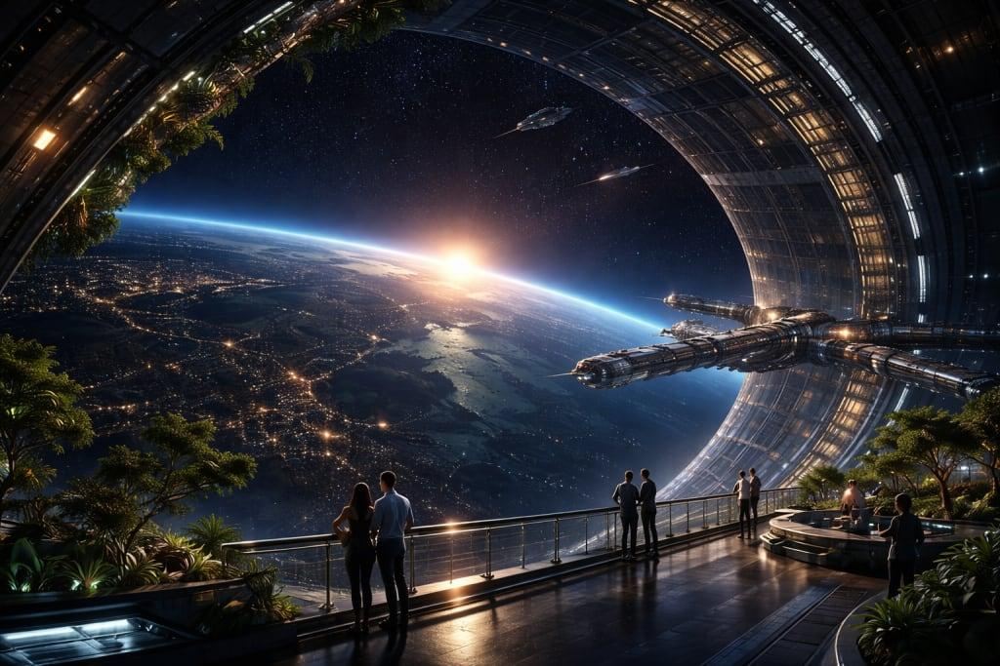

# Observationsdäckets visuella mål

Användarens referens, 2026-11-11:

## Fastställd riktning
- Mörkt, djupt välvt panoramafönster med tät panelindelning och flera lager.
- Planetens horisont lågt över utsikten, med atmosfärisk kant och varmt motljus.
- Grönska längs kanterna, både planteringsbäddar och hängande växter.
- Diskreta varma och kalla ljuslister; mörkt golv med kontrollerade reflexer.
- Fartyg utanför ger skala och liv. Människorna i referensen ger skala;
  NPC-system är ännu inte implementerat genom denna referens.

## Nuvarande implementation
Carrier-skysfären använder användarens befintliga `space.jpg` (7556 × 2400).
Den mappas med sfärens befintliga UV:er; bilden är inte ett exakt 2:1-panorama.
Originalet behålls. Referensbilden används som art direction, inte som scenbakgrund.
Världsväxling och befintliga möbler finns kvar. Planetkomposition och valv har
vidareutvecklats enligt nedan.

## Genomfört presentationspass
- Lägre planetplacering och större skala ger en horisont under rymdutsikten.
- Atmosfärisk kant med färg per värld.
- Segmenterade paneler i tak och fönstervalv, diskreta ljusfält.
- Två breda ljus över planteringsbäddarna.
- Tre långsamma serviceskyttlar, återanvända från befintlig modell.
- **ENJOY THE VIEW** döljer rummets kontroller. Escape eller återgångsknappen
  återställer dem utan att lämna observationsdäcket.

## Kvar mot referensen
Vitrum och Collective behöver slutlig yttextur. Fartygsmodellen är en återanvänd
serviceskyttel, inte referensens stora kryssare. Varm soluppgång, detaljerade
metalltexturer och verkliga golvreflexer återstår. Inga besökande NPC:er införda.
Den befintliga planet-/rumsidentiteten ska bevaras även när referensen inspirerar.
